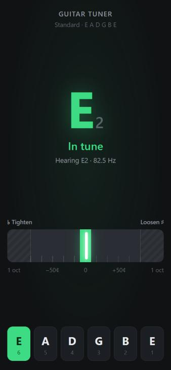

# Guitar Tuner 🎸

A free, open-source guitar tuner for **iPhone, iPad, Android and the web**.
Pick a string, pluck it, and turn the peg until it goes green.



- **You choose the string.** The tuner measures against the string you
  picked, not whatever note is closest. If you're tuning the high E and the
  string is sitting at a B, it tells you to tighten 5 semitones, instead of
  saying "B, in tune".
- **Gray until it's right, green when it is.** Within 5 cents of the target,
  the note, the meter and the string button light up green.
- **A meter that works from far away.** The middle of the meter is a fine
  ±50 cent scale; the shaded ends stretch out to a full octave, so even a
  badly slack string puts the needle on the right side and moves it as you
  turn.
- Standard tuning (E A D G B E).
- Works offline. No ads, no accounts, no tracking. The microphone is only
  used to hear the string; audio never leaves the device and is never
  recorded.

**Use it in a browser:** <https://icodeforbananas.github.io/guitar-tuner/>

## Download

| Platform | How                                                                                                     |
| -------- | ------------------------------------------------------------------------------------------------------- |
| Android  | Google Play (coming soon), or the `.apk` on the [latest release](../../releases/latest) or latest [CI run](../../actions/workflows/ci.yml) |
| iOS      | App Store (coming soon), or sideload the `.ipa` from the latest [CI run](../../actions/workflows/ci.yml) |
| Web      | <https://icodeforbananas.github.io/guitar-tuner/>, then tap **Install** on the start screen (on iPhone/iPad: Share → Add to Home Screen). Works offline once installed. |

## How it works

- `src/lib/pitch.ts`: pitch detection with the
  [McLeod Pitch Method](https://www.cs.otago.ac.nz/research/publications/oucs-2008-03.pdf).
  A plucked string's second harmonic is often louder than its fundamental,
  which makes simple autocorrelation jump an octave; MPM takes the first
  strong period instead of the strongest one.
- `src/lib/tuning.ts`: the strings, cents from the chosen target, the
  tighten/loosen guidance, and the two-zone meter scale.
- `src/useTuner.ts`: the microphone. Reads it through the Web Audio API with
  the browser's voice processing (echo cancellation, noise suppression, auto
  gain) turned off, and smooths readings with a short median.
- `src/TunerApp.tsx`: the screen.
- `src/pwa.ts`: web-only install support (service worker for offline use,
  the browser's install prompt).
- `android/` and `ios/`: native shells, generated by
  [Capacitor](https://capacitorjs.com), that load the built web app. They
  add the microphone permission (`RECORD_AUDIO` on Android,
  `NSMicrophoneUsageDescription` on iOS).

## Develop

You need Node 22. For the native apps you also need JDK 21 and the Android
SDK (Android Studio installs both) for Android, and a Mac with Xcode for iOS.

```
npm install
npm run dev        # open http://localhost:5173
npm test           # unit tests for pitch detection and tuning math
npm run android    # build, sync and open in Android Studio
npm run ios        # build, sync and open in Xcode (macOS only)
```

Browsers only allow the microphone on `https://` or `localhost`. To try it on
a phone from your dev machine, use `npm run dev -- --host` and a tunnel that
gives you HTTPS, or use the deployed site.

No Mac or Android Studio? Push a branch or open a pull request: CI builds an
Android `.apk` and an unsigned iOS `.ipa` and attaches them to the run.

See [CONTRIBUTING.md](CONTRIBUTING.md) to get involved, and
[docs/RELEASING.md](docs/RELEASING.md) for how releases reach the stores.

## License

[MIT](LICENSE)
